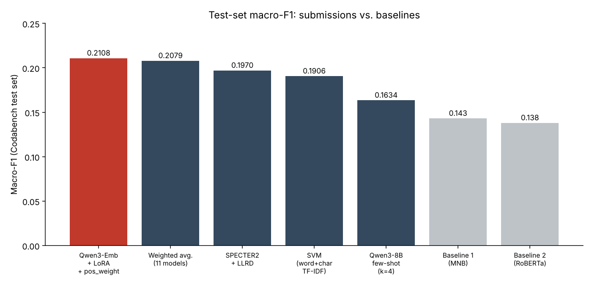
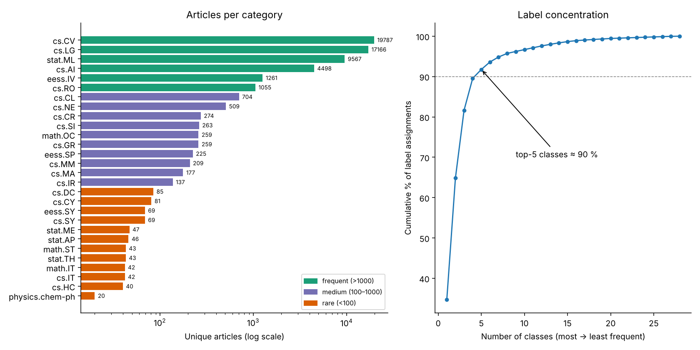
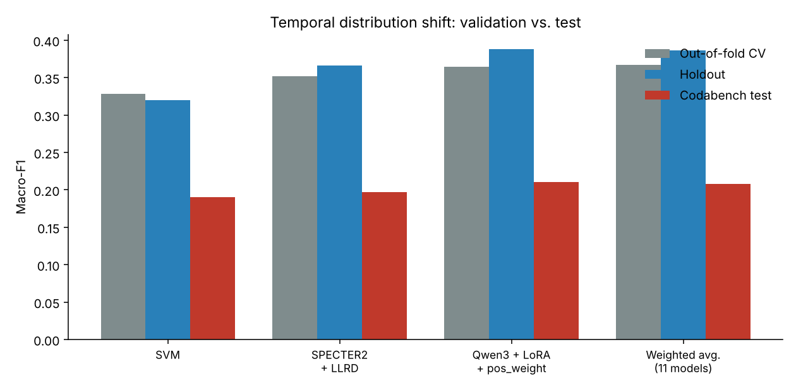

# Multi-label Classification of Scientific Papers

**Classical models, fine-tuned Transformers, ensembles and few-shot LLMs on arXiv abstracts.**

Final project for *Computational Linguistics* — Master's in Artificial Intelligence, Pattern Recognition and Digital Imaging (**MIARFID**), Universitat Politècnica de València (UPV), 2026–2027.


**Authors:** Carlos Broch Cubedo · Ferran Artero Merino — team **LC-02** on Codabench

---

## Overview

Given the **title and abstract** of a scientific paper, predict its set of arXiv categories (e.g. `cs.CV`, `cs.LG`, `stat.ML`). A paper can belong to several categories at once, so this is a **multi-label** problem over **L = 28** classes with a variable number of labels per paper (1–4).

The task was run as a competition on [Codabench](https://www.codabench.org/) against two provided baselines (a Multinomial Naive Bayes and a fine-tuned `roberta-base`). The primary metric is **macro-F1**, which weights all 28 classes equally and therefore rewards systems that do well on rare categories.

### Headline results

| | Macro-F1 (test) |
|---|---|
| Baseline 1 (Count-5k + MNB) | 0.143 |
| Baseline 2 (RoBERTa) | 0.138 |
| **Best system: Qwen3-Embedding-0.6B + LoRA + `pos_weight`** | **0.2108** (+47 % / +53 % over the baselines) |



---

## Key findings

1. **Per-class decision thresholds are the single most valuable trick.** They add 2–10 macro-F1 points to classical models at essentially zero cost, and were applied to every model in the project.
2. **Domain-appropriate pre-training beats architecture.** Science-specific encoders (SPECTER2, SciBERT) outperform general-purpose ones; the most recent model (Qwen3), which already knows part of the test-set terminology, wins on the competition set.
3. **Character n-grams** consistently help the classical models; **LoRA** and **`pos_weight`** give small but consistent gains for Transformers.
4. **Rigorous validation matters.** Deduplication, iterative stratification and cross-fitted thresholds/combiners prevented a wrong model choice (SPECTER2 + LoRA looked best on a single fold, but the advantage vanished with 3 folds).
5. **Strong temporal distribution shift.** The test set contains more recent papers; macro-F1 drops 37–46 % between holdout and test. Local validation ranks models correctly but does not predict absolute leaderboard scores.
6. **What did not work:** a hierarchical (root + secondary labels) approach, "smart" deduplication (differences within noise), heavy stacking meta-classifiers (overfit), and few-shot LLM prompting (cannot learn the corpus' labelling conventions from a handful of examples).

---

## Data

| | |
|---|---|
| Source | [arXiv paper abstracts (Kaggle)](https://www.kaggle.com/datasets/spsayakpaul/arxiv-paper-abstracts/data), filtered to the 28 most frequent categories |
| Train | 43,555 rows → **32,577 unique papers** (columns: `titles`, `summaries`, `terms`) |
| Test | 4,885 more recent papers, unlabeled (extra `keywords` column, not used — closed vocabulary of 29 terms that doesn't exist in train) |
| Labels | 28 arXiv categories, 1–4 per paper (1.75 on average; 71 distinct combinations) |

> **The data is not included in this repository.** It is distributed through the course's Codabench competition (registration required). See [`data/README.md`](data/README.md) for how to place it.

### Exploratory analysis — what shaped the design

| Finding | Consequence |
|---|---|
| **25 % of rows are duplicates** (some papers appear up to 7×; labels almost never conflict) | All splits are made over *unique* papers to avoid leakage |
| **Extreme imbalance:** `cs.CV` has 19,787 papers, `physics.chem-ph` has 20 (~1000×); 12 of 28 classes have < 100 papers; top-5 classes hold 90 % of assignments | Class weights, per-class thresholds, macro-F1 as selection criterion |
| **Hierarchical label structure:** every paper has at least one root (`cs.CV`, `cs.LG` or `stat.ML`); three alias pairs always co-occur (`cs.IT`/`math.IT`, `cs.SY`/`eess.SY`, `math.ST`/`stat.TH`) | Post-processing: ≥ 1 root, ≤ 4 labels, aliases always together |
| **Train → test shift:** adversarial validation AUC = 0.98; 48 % of test word types never appear in train (*LLM*, *LoRA*, *in-context*, *agentic*) | Favour character n-grams and recent pre-trained models; local metrics are for *ranking*, not for predicting leaderboard scores |



---

## Methodology

### Shared protocol (all systems are directly comparable)

1. **Deduplicate** by normalized title + abstract; each unique paper gets the union of its copies' labels.
2. **Input text:** `title. abstract`.
3. **Binarize** labels with `MultiLabelBinarizer` (28-dim vectors).
4. **Split:** 15 % of unique papers held out (never used for any decision) + 3-fold `MultilabelStratifiedKFold` on the rest for model, hyper-parameter and threshold selection.
5. **Per-class thresholds** maximizing each class' F1, fitted by **cross-fitting** to avoid optimistic bias.
6. **Post-processing:** at least one root label, at most four labels, alias pairs always together.
7. **Selection criterion:** out-of-fold macro-F1 (± std across folds), fixed in advance.

### 1 · Classical models (`notebooks/02_classical_models.ipynb`)

TF-IDF + one-vs-rest linear classifiers (Multinomial/Complement NB, Logistic Regression, Linear SVM), 51 configurations searched over n-gram ranges (1,1)–(1,3).

- ✅ **Per-class thresholds** — SVM macro-F1 0.2295 → 0.3233
- ✅ **Word (1,2) + character (2–5) TF-IDF** — gains for all three classifiers
- ➖ "Smart" deduplication (keep all copies only for papers with a minority class) — within noise
- ❌ Hierarchical root/secondary approach — hurts: wrongly predicted secondary labels impose wrong roots
- ❌ WordPiece sub-words — no gain over character n-grams

**Final classical model:** Linear SVM, word (1,2) + char (2–5) TF-IDF, `C=0.05`, `class_weight="balanced"`, per-class thresholds → OOF macro-F1 **0.3288**.

### 2 · Transformers (`notebooks/03_transformers.ipynb`)

Shared recipe: encoder + `[CLS]` head (dropout 0.1, 28 sigmoid outputs, bias initialised to the class log-odds), BCE loss, AdamW (3e-5 encoder / 10× head), 4 epochs, effective batch 32, last epoch kept (no best-epoch selection on validation).

**Frozen embeddings** (LogReg / kNN): none beats the SVM — best is SPECTER2 (0.3134).

**Fine-tuning (fold 1, macro-F1):**

| Model | Macro-F1 |
|---|---|
| SVM (reference) | 0.3145 |
| DeBERTa-v3 | 0.2688 |
| RoBERTa | 0.3201 |
| ModernBERT | 0.3238 |
| SciBERT | 0.3394 |
| Qwen3-Embedding-0.6B + LoRA | 0.3428 |
| **SPECTER2** | **0.3473** |

**Ablations** on the top-3 models: `pos_weight`, LoRA, layer-wise LR decay (LLRD), classifier re-training (cRT). LoRA helps the encoders; `pos_weight` helps Qwen3 by > 2 points; cRT clearly hurts.

**Final models, all trained on the 3 folds (test prediction = mean of the 3 fold models):**

| Model | OOF macro-F1 | Holdout macro-F1 |
|---|---|---|
| SVM | 0.3288 ± 0.0049 | 0.3277 |
| SPECTER2 | 0.3481 ± 0.0055 | 0.3497 |
| SPECTER2 + `pos_weight` | 0.3505 ± 0.0043 | 0.3651 |
| SPECTER2 + LoRA | 0.3444 ± 0.0080 | 0.3686 |
| SPECTER2 + LLRD | 0.3519 ± 0.0082 | 0.3665 |
| SciBERT + LoRA | 0.3488 ± 0.0068 | 0.3595 |
| **Qwen3 + LoRA + `pos_weight`** | **0.3643 ± 0.0018** | **0.3879** |

### 3 · Ensembles (`notebooks/04_ensembles.ipynb`)

Six combiners (mean, greedy weighted mean à la Caruana, voting, per-class stacking, all-class stacking, LightGBM stacking) × five model groups = **30 combinations**, using nested cross-fitting on standardized out-of-fold scores.

Simple combiners tie with the best single model (best: weighted mean of 11 models, 0.3668 vs 0.3643, inside the fold std). Flexible stackers overfit: −1.7 to −3.6 points (LogReg) and −3.9 to −5.5 points (LightGBM).

### 4 · Few-shot LLM (`notebooks/05_fewshot_llm.ipynb`)

Training-free approach: **Qwen3-8B** (no thinking mode, vLLM, greedy decoding) receives the 28 category names and *k* retrieved examples — the nearest training papers by SPECTER2 embedding. Macro-F1 grows with *k* up to 0.2581 (k = 4) on a 1,009-paper holdout subset, still far below fine-tuned models: the LLM knows the topics but not the labelling criteria of the corpus (e.g. over-predicts `cs.IR` and `cs.IT`).

---

## Results

All Codabench submissions, ordered by test macro-F1 (precision / recall / accuracy / Hamming loss are test-set values):

| # | Model | CV F1 | Holdout F1 | **Test F1** | Prec. | Recall | Acc. | HL |
|---|---|---|---|---|---|---|---|---|
| 1 | **Qwen3 + LoRA + `pos_weight`** | 0.3643 | 0.3879 | **0.2108** | 0.1889 | 0.3483 | 0.2188 | 0.0459 |
| 2 | Weighted mean (11 models) | 0.3668 | 0.3862 | 0.2079 | 0.1882 | 0.3256 | 0.2274 | 0.0454 |
| 3 | SPECTER2 + LLRD | 0.3519 | 0.3665 | 0.1970 | 0.1725 | 0.3062 | 0.2426 | 0.0454 |
| 4 | SVM (word + char TF-IDF) | 0.3288 | 0.3198 | 0.1906 | 0.1603 | 0.3203 | 0.2395 | 0.0455 |
| 5 | Qwen3-8B few-shot (k = 4) | — | 0.2581† | 0.1634 | 0.1236 | 0.3403 | 0.1132 | 0.0592 |
| – | Baseline 1 (Count-5k + MNB) | — | 0.2202 | 0.143 | 0.113 | 0.495 | 0.111 | 0.084 |
| – | Baseline 2 (RoBERTa) | — | — | 0.138 | 0.145 | 0.160 | 0.371 | 0.034 |

† 1,009-paper holdout subset.



**A note on metrics.** Baseline 2 has the best accuracy and Hamming loss only because it predicts very few labels (recall 0.160) — exactly the behaviour macro-F1 penalizes. Our models, with thresholds tuned for macro-F1, strike a balance and predict a bit more than two labels per paper.

### Future work

- Continue pre-training the encoder (unsupervised) on test-set abstracts — domain adaptation to the shift.
- LoRA-tune larger, more recent LLM backbones that already know current terminology.
- Build a validation set that mimics the test set, using training papers the adversarial classifier confuses with test papers.

---

## Repository structure

```
.
├── notebooks/
│   ├── 01_eda.ipynb                 # duplicates, imbalance, label structure, train/test shift
│   ├── 02_classical_models.ipynb    # TF-IDF + NB / LogReg / SVM, thresholds, char n-grams
│   ├── 03_transformers.ipynb        # frozen embeddings, fine-tuning, ablations, final models
│   ├── 04_ensembles.ipynb           # 6 combiners × 5 model groups
│   └── 05_fewshot_llm.ipynb         # Qwen3-8B few-shot with retrieved examples (vLLM)
├── docs/
│   ├── report_es.pdf                # full project report (Spanish, 24 pp.)
│   └── slides_es.pptx               # presentation (Spanish)
├── assets/                          # figures used in this README
├── data/                            # place the Codabench datasets here (not tracked)
├── requirements.txt
└── LICENSE
```

## Reproducing the experiments

The notebooks were developed and run on **Google Colab** (01–04) and **Kaggle** (05, 2× T4 GPUs, vLLM). They share the same preprocessing and split, so they can be re-run in order. Each notebook starts with a configuration section where data/output paths are set.

```bash
git clone <this-repo-url>
cd <repo>
pip install -r requirements.txt
# put dataset_train.csv and dataset_test.csv into data/ (see data/README.md)
jupyter lab notebooks/
```

Notes:
- Notebooks 02–04 mount Google Drive via `google.colab`; when running locally, adjust the paths in the configuration cell.
- Fine-tuning a Transformer takes ≈ 20 min per fold on a T4-class GPU.
- Notebook 05 needs `vllm==0.11.0` and a GPU setup comparable to 2× T4.
- Notebook text and the report are written in Spanish (course language); this README is the English entry point.

## Tech stack

`scikit-learn` · `iterative-stratification` · `PyTorch` · `Hugging Face Transformers` · `PEFT (LoRA)` · `vLLM` · `LightGBM` · `pandas` / `NumPy` · `matplotlib` / `seaborn`

Models used: `allenai/specter2_base`, `allenai/scibert_scivocab_uncased`, `Qwen/Qwen3-Embedding-0.6B`, `Qwen3-8B`, `roberta-base`, `microsoft/deberta-v3-base`, `answerdotai/ModernBERT-base`, `BAAI/bge-large-en-v1.5`, `intfloat/e5-large-v2`.

## Authors

- **Carlos Broch Cubedo**
- **Ferran Artero Merino**

MIARFID · Universitat Politècnica de València

## License

Code released under the MIT License (see [`LICENSE`](LICENSE)). The dataset is **not** covered by this license and remains subject to its original terms.
